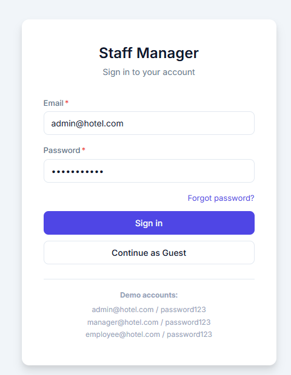
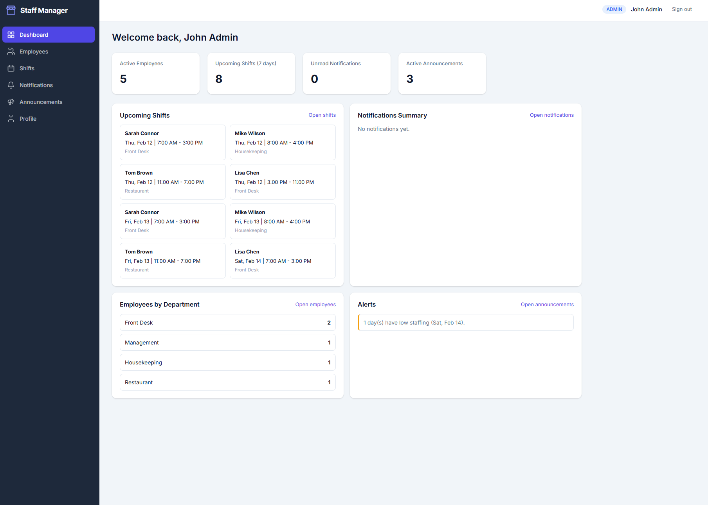
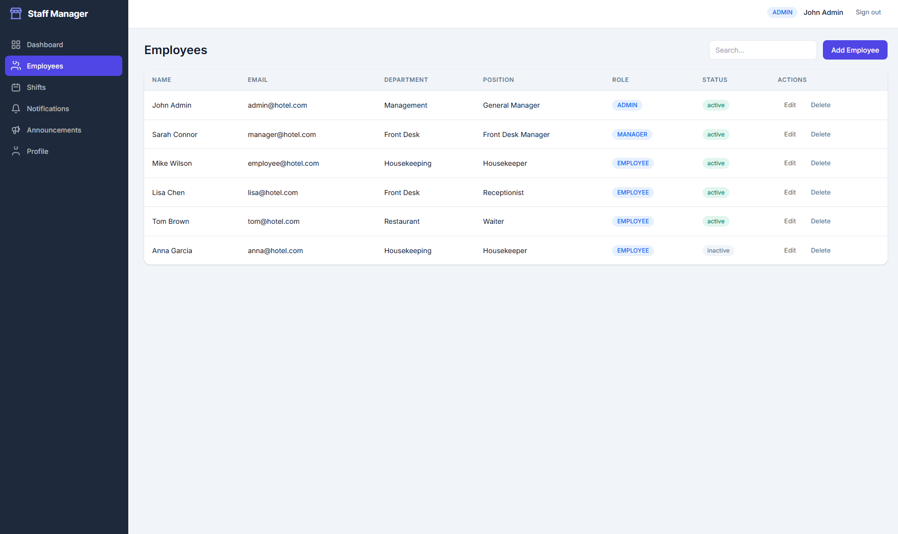
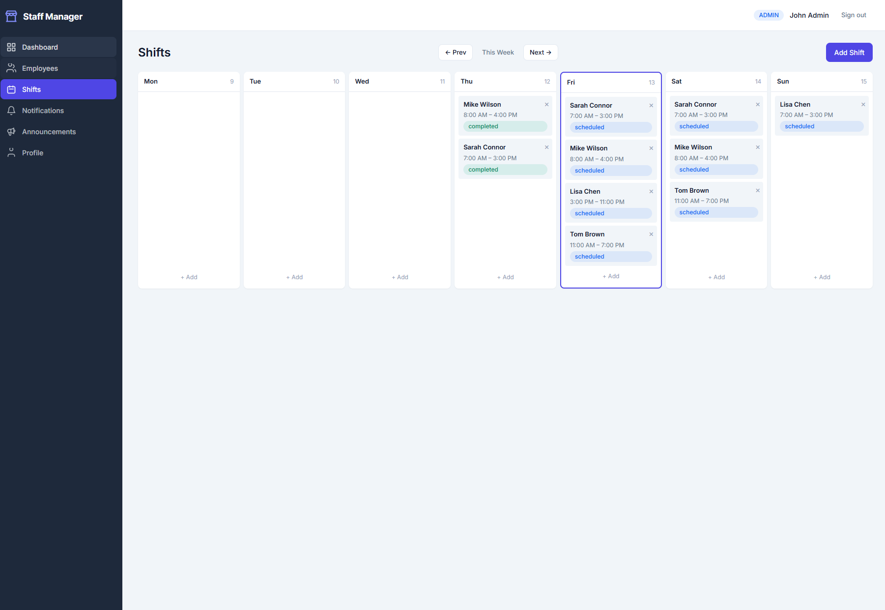
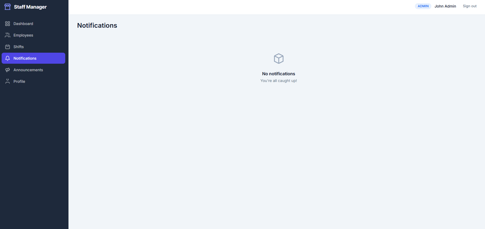
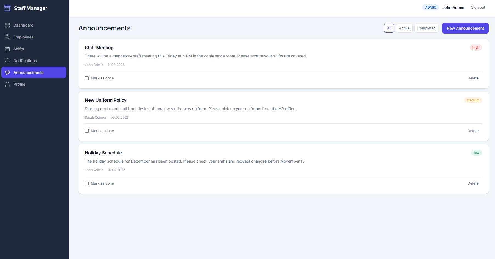
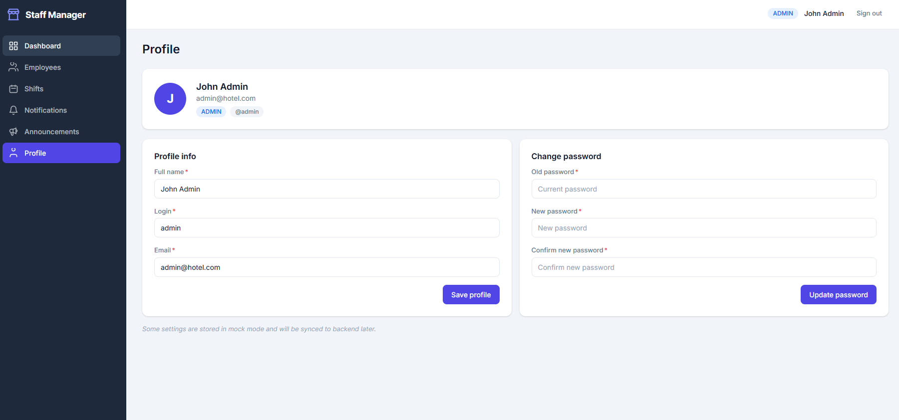

# Staff Manager Frontend

Hotel staff operations app with an optional Express/Prisma backend. The frontend defaults to MSW mock mode for local UI work.

## Features
- Auth with roles: `ADMIN`, `MANAGER`, `EMPLOYEE`, plus `GUEST` login.
- Guest mode with read-only access to dashboard and core views.
- Forgot/Reset password as UI wrapper flow (mock only).
- Dashboard with quick insights (employees, shifts, notifications, announcements).
- Monthly employee shift matrix with day/night types and API-backed leave, sick, and unavailable marks.
- Shift task checklists and next-shift handover with acknowledgement tracking.
- English, Czech, and Russian interface options; responsive navigation and light/dark themes.
- Role-aware notifications for shifts, employees, schedule conflicts, and announcements.
- Notifications with an unread counter, details modal, `Mark all as read`, and `Clear all`.
- Announcements with filters, completion state, and delete action.
- Profile forms for updating session info and password (mock behavior).
- Attendance removed from routes/navigation.

## Tech Stack
- React 19 + TypeScript
- Redux Toolkit + RTK Query
- React Router
- React Hook Form + Zod
- SCSS Modules
- MSW (API mocking)
- Vitest + React Testing Library

## Project Preview
### Login


### Dashboard


### Employees


### Shifts


### Notifications


### Announcements


### Profile


## Run
```bash
npm install
npm run dev
```

## Validation
```bash
npx tsc -b
npm run lint
npm test
```

## Demo Access
- `admin@hotel.com / password123`
- `manager@hotel.com / password123`
- `employee@hotel.com / password123`
- Guest: click `Continue as Guest` on `/login`

## Mock Mode
- API calls are intercepted by MSW handlers in `src/mocks/handlers/*`.
- Session keys in `localStorage`:
  - `access_token`
  - `auth_user`
- Mock persistence key:
  - `staff_manager_mock_state_v1`

### Notification behavior
- Employees receive notifications only for shifts assigned to their linked account, shift changes/cancellations, and new announcements.
- Admins and managers receive notifications about employee record changes and overlapping shifts (except for the manager who performed the action). Announcements are delivered to all other employee, admin, and manager accounts.
- Opening an unread notification marks it as read. Users can mark all as read or clear only their own notifications; guest mode remains read-only.
- New notifications are kept in the mock persistence store, ordered newest-first, and the sidebar unread counter refreshes periodically while the app is open.
- Employee records without a linked app account (`userId`) cannot receive personal notifications. SMS, browser push, and real-time server events are not implemented.

## Backend

The Express + Prisma API in `backend/` implements authentication, employees, shifts, absences, notifications, announcements, tasks, and handovers. Password reset links use one-time hashed tokens and SMTP. A five-minute scheduler handles task carry-over, handover forwarding, overdue-task reminders, and critical handover escalation.

Run the frontend and API separately using [backend/README.md](backend/README.md), or start the Docker Compose setup from the project root. For API mode set `VITE_USE_MOCKS=false`; set `VITE_API_URL` if the API is not served through the Compose `/api` proxy.

## Backend Integration Points
1. `src/app/baseApi.ts` - base URL, auth headers, and shared RTK Query config.
2. `src/features/*/api/*.ts` - RTK Query endpoints per feature.
3. `src/mocks/handlers/*` - mock implementation selected by `VITE_USE_MOCKS`.
4. `backend/src/routes/*` - API routes.
